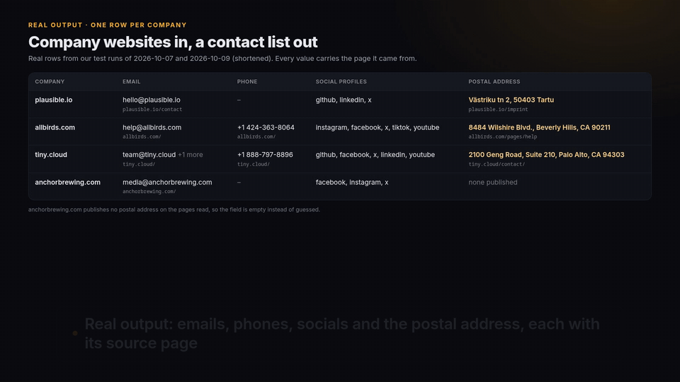

# Company websites or Google Maps results to a contact list: emails, phones, socials and postal address

Runnable Python and Node.js examples for [Contact Details Scraper & Google Maps Email Extractor](https://apify.com/hiver/company-contact-details?utm_source=github&utm_campaign=company-contact-details), an Apify Actor built by hiver.

You give it a list of company websites (`plausible.io`, `https://www.example.com/en`). It reads each company's home page and the contact, about, imprint/legal and support pages linked from it (5 pages by default), and returns **one row per company**: role emails (info@, sales@, support@, press@), phone numbers, LinkedIn / X / Facebook / Instagram / YouTube / GitHub / TikTok profiles, the contact page and the postal address. Every value carries the page it was found on, so you can check it in one click.

```
domain,companyName,status,emails,emailTypes,phones,address,addressSourceUrl,contactPageUrl,linkedin,x,...
plausible.io,Plausible Analytics,ok,hello@plausible.io,general,,"Västriku tn 2, 50403 Tartu",https://plausible.io/imprint,https://plausible.io/contact,https://www.linkedin.com/company/plausible-analytics,https://x.com/PlausibleHQ,...
anchorbrewing.com,Anchor Brewing | Find Craft Beer Near You | Tour Brewery.,ok,media@anchorbrewing.com,press,,,,,,https://x.com/AnchorBrewing,...
```

These rows are real output from the Actor's test bench on 2026-10-09 (shortened).



[Watch the 1-minute walkthrough (MP4, 1080p)](media/contact-details/walkthrough.mp4)

**New: Google Maps results in, emails out.** Point the Actor at a Google Maps Scraper dataset and get one row per place, with the place's own name, address and phone kept next to the contacts from its website. Places without a website are free. See [`google-maps/`](google-maps/) for a script that takes a dataset ID or runs the Maps search for you.

## Run it

You need an Apify account (the free plan includes $5 of usage a month) and its API token from Apify Console > Settings > API & Integrations.

Python 3.11+:

```bash
cd python
pip install -r requirements.txt
export APIFY_TOKEN=your_token
python contacts_to_csv.py plausible.io posthog.com hetzner.com
python contacts_to_csv.py --file domains.txt --out leads.csv
```

Node.js 18+:

```bash
cd node
npm install
export APIFY_TOKEN=your_token
node contacts-to-csv.mjs plausible.io posthog.com hetzner.com
node contacts-to-csv.mjs --file domains.txt --out leads.csv
```

Both write `contacts.csv` (or `--out`) with one row per company: `emails`, `emailTypes` and `phones` joined with `; `, one column per social network, `address` with `addressSourceUrl`, and `status` / `failureReason` for sites that could not be read. Options: `--file` (one website per line; `#` comments and duplicates are skipped), `--max-pages` (pages read per site, 1-12, default 5), `--country` (default country for phone numbers written without a `+` code, e.g. `US` or `DE`), `--max-charge` (the run stops once it has cost this many dollars; default $1.00).

No code: open the [Actor page](https://apify.com/hiver/company-contact-details?utm_source=github&utm_campaign=company-contact-details), paste the websites and download CSV, Excel or JSON.

## Which rows to check by hand

Every email, phone and address says how it was read (`foundVia`): `structured_data` (the site's JSON-LD / schema.org data), `link` (a `mailto:` or `tel:` link), `address_tag` (an HTML `<address>` element), `decoded_obfuscation` (an address the site hides from bots) or `page_text` (plain text on the page). The scripts write these as `emailFoundVia`, `phoneFoundVia` (same order as `emails` and `phones`) and `addressFoundVia`, and set `reviewFirst` to `yes` when any value in the row came from `page_text` or `decoded_obfuscation`. That rule is a starting point, not a measured confidence score: edit `REVIEW_IF` at the top of the script to fit your list. The Actor's JSON also gives `pageType` per value (home, contact, imprint, about, support, press, legal or other). Thanks to a dev.to reader for asking for this.

Real example from the board's test run of build 0.2.9 (2026-10-11): for plausible.io, `hello@plausible.io` came from a `mailto:` link on the contact page (`foundVia: link`, `pageType: contact`), and the address `Västriku tn 2, 50403 Tartu` was read from the text of the imprint page (`addressFoundVia: page_text`, `addressPageType: imprint`), so that row gets `reviewFirst: yes`.

## What it costs

$2 per 1,000 websites where at least one contact detail was found, on the free plan ($1.70 to $1.90 on paid Apify plans), with no start fee. You pay per website, not per page crawled, so you know the cost before you start. Websites that cannot be reached, sites with nothing found, places without a website and social-only websites are listed with a reason and are not charged.

## What we measured

Our test bench ran this Actor and three other contact-details Actors from the Apify Store on the same 6 company websites (3 SaaS companies, 2 small businesses, 1 language school whose site redirects by locale) and checked 17 facts that the companies publish: emails, phones, social profiles and postal addresses. Bench run 2026-10-09 12:33 UTC, build 0.2.3:

| | This Actor | jfaro19/website-contact-finder | poidata/contact-details-scraper | solidscrape/contact-details-scraper |
|---|---|---|---|---|
| Known facts returned correctly | **17 of 17 (100%)** | 13 of 17 (76%) | 11 of 17 (65%) | 10 of 17 (59%) |
| Fields filled | **59%** | 56% | 55% | 44% |
| Bench runs that succeeded | 3 of 3 | 3 of 3 | 3 of 3 | 3 of 3 |
| Average run time per case | 32.0 s | 5.6 s | 45.6 s | 15.7 s |
| What a Store user paid per 1,000 results in these runs | $1.93 | $3.02 | $2.02 | $1.27 |

Read it fairly: six websites are a small sample, and fields filled is only 3 points ahead. jfaro19/website-contact-finder is much faster and solidscrape/contact-details-scraper costs less per result. The bench covers these three Actors only, not every contact scraper on the Store, and it runs again after every new build. Only this Actor returned the postal address plausible.io publishes on its imprint page.

## What it does not do

- Company channels only: role mailboxes and business mailboxes the site itself publishes. No personal emails, no email guessing or verification, no data bought from third parties.
- It reads the HTML a server sends. Sites that build their pages only in the browser return `no_contacts_found` with the reason `page_builds_content_with_javascript`.
- It respects `robots.txt`, does not log in, and never pretends to be a browser (its User-Agent names the Actor). An HTTP 403 is retried once through Apify's datacenter proxy with the same User-Agent; a site that keeps refusing is reported as failed.
- Many large companies publish only a contact form. You will get their social profiles and phones, and `emails` can be empty: that is what the site publishes.

Use the data lawfully. You are responsible for how you contact the businesses behind these addresses (GDPR, CAN-SPAM, PECR and similar).

## Notes

- Unofficial. Not affiliated with, endorsed by or sponsored by any website or company it reads.
- Something wrong or missing? Open an issue on the Actor's Issues tab on Apify, or here. Each report becomes a test case for the next build.

MIT licensed examples. Built by [hiver](https://apify.com/hiver?utm_source=github&utm_campaign=company-contact-details).
